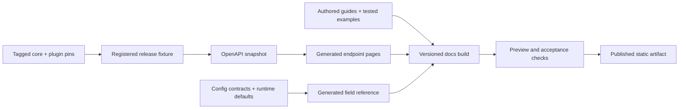

# Hyperion documentation redesign for 4.5

Proposal · 2026-10-20 · No production migration or publication performed.

Rebuild the docs around two equally important readers: API developers and node operators. Give both a short path to a verified result, then provide the reference and operational depth they need. Use the Hyperion identity on the Rio Blocks visual system, with a task-based homepage and a persistent handbook shell for articles.

The user confirmed the balanced audience and then authorized starting the recommended direction. The task homepage and Docusaurus handbook now have a [working foundation and validation record](foundation.md); the remaining release scope below is still proposed or awaiting qualification. [Research and full 24-page disposition](research.md) contain the source evidence. [Composition studies](visual-direction.md) explain the three previews.

## Why this needs more than a new theme

The current site already has search, code copying, navigation tabs, and a configured mike version provider. Those are existing capabilities. The work is to improve their usefulness, correct the content, and make the much larger 4.5 product understandable. Actual historical version deployments were not verified. [Current configuration](https://github.com/eosrio/hyperion-docs/blob/3f6759653e2c2c3ccf5ed72ebe61cacde6d2b0d8/mkdocs.yml)

The audit found 24 public content pages, all in navigation. Several are useful foundations, particularly index management and the separate Explorer guide. The gaps affect whether someone can succeed:

- Installation variants disagree about supported Ubuntu/runtime combinations; the LXD guide uses a 3.3.9-5 image.
- Configuration paths differ from the current CLI, and the developer starter shows console output as JSON.
- The API reference advertises endpoints absent from the inspected core and omits existing route families.
- Streaming replay defaults are described without matching evidence in the inspected source.
- The public structure has no complete 4.5 migration, extension, compatibility, or release-readiness journey.

These findings are traced to individual docs and source lines in [the correctness table](research.md#highest-impact-correctness-findings). This was a source audit, not an executed installation or public-provider acceptance test.

## The reader experience

### A homepage that starts the work

Use the **Start with a task** composition for the homepage. Put a short product explanation, search, a real bounded query example and four direct routes in the first desktop viewport:

| Route | First useful outcome |
|---|---|
| Query blockchain data | A successful request, an explained response, and the next filtering or pagination step. |
| Run Hyperion | A supported installation choice, prerequisites, and an observable indexing check. |
| Build a plugin | The appropriate extension seam and its current maturity and compatibility. |
| Upgrade to 4.5 | Supported starting points, preflight checks, change sequence and rollback limits. |

The preview query uses an illustrative block range. The real quickstart should use a committed fixture that contains matching data and a tested public-provider alternative; do not imply every provider retains those blocks.

### A handbook inside every section

Use the **Hyperion handbook** composition for guides and reference: compact masthead, section navigation, contextual left sidebar, a 65–75 character reading column, and a right-hand contents rail when space permits. Keep the active section and product release visible. Search and mobile navigation remain reachable while reading.

The **4.5 release workspace** composition is best used for a dedicated release page. It gives new capabilities, readiness, migration and supported component sets a clear home without requiring a permanent release campaign on the main index.

The studies show proposed structure and content. Their search boxes, code tabs and version labels are illustrative, and only dark compositions are supplied at this stage. Full light, mobile-navigation, search, and keyboard behavior belong to the implementation acceptance below.

### The visual system

Carry forward the confirmed Hyperion mark, blue #0094d2, and the Rio Blocks system: near-black #050505, restrained tonal surfaces, hairlines, 4px corners, Inter for reading and JetBrains Mono for code and identifiers. Provide a complete light theme on #f6f6f3. Blue marks links, focus and selection; teal and amber communicate status with accompanying text. Keep the small “by Rio Blocks” credit.

Use the flat gem and heartbeat H already established in the adjacent API prototype. Motion may briefly draw the mark; reading and navigation stay still, and reduced-motion preference suppresses animation. Self-host production fonts. Avoid background effects behind prose and oversized promotional artwork above the first useful link.

## Proposed information architecture

| Section | Content |
|---|---|
| Start | Introduction; first query; first local instance; how Hyperion works; release and API version terminology. |
| Build | Action filtering; pagination; transactions; state and balances; streaming/replay; finality; errors and retries; worked recipes. |
| Operate | Compatibility and sizing; development/production install; configuration; indexing and verification; monitoring; queues/backpressure; scaling; retention/archive; backup and recovery. |
| Extend | Extension model; current legacy plugins; 4.5 SDK status; contract projections; protocol adapters; backend adapters; compatibility and conformance. |
| Reference | Generated API history/state/stats pages; v1 compatibility; plugin domains; configuration fields; CLI commands; glossary. |
| Releases & upgrades | Verified current release; 4.5 preview; migration and rollback; tested component sets; known limitations; historical docs. |

Tools and ecosystem get a small secondary directory linked from relevant workflows: Hyperion Tools, Explorer, Stream Client, providers, and maintained integrations. Individual crate READMEs remain the owners of detailed tool procedures; the site provides orientation, maturity, pinned versions and links. This avoids publishing two drifting copies.

Each section mixes concepts and tasks where the reader needs them. A query guide should link directly to finality and pagination semantics; a backend switch guide should explain completeness and cutover at the relevant step.

## Improvements that materially change the docs

| Improvement | Concrete behavior | Priority |
|---|---|---|
| First-success guides | Runnable curl and JavaScript, valid request/response fixtures, expected output, failure handling and next step. No installation prerequisite for an API consumer. | Release |
| Generated endpoint reference | One endpoint per page, required fields/defaults, examples, errors, provider/plugin conditions and downloadable pinned OpenAPI. | Release |
| Query recipes | Latest actions, bounded ascending scans, historical pagination, transaction block hints, current state, replay plus live updates. Teach limits and tradeoffs with each recipe. | Release |
| Search by the terms users have | Index endpoint paths, config keys, CLI commands, exact errors and previous page titles; scope results to the selected release by default. | Release |
| Installation decision guide | Development and production choices share a tested dependency matrix, exact artifacts, current paths and an end-to-end verification step. | Release |
| Operational runbooks | Symptom → evidence to collect → likely causes → scoped action → verification. Distinguish indexed-data repair, projection recovery and node log repair. | Release |
| Release-aware architecture | Diagrams of ingestion, history and state serving, plus projection lifecycle and fork behavior, labeled by implementation status. | Release |
| Searchable config reference | Types, effective defaults, constraints, file scope, restart/reload behavior, examples, introduced release and source. | Release |
| Compatibility catalog | Core, SDK, plugin, adapter, storage engine and protocol pins remain separate; show tested combinations and evidence dates. | Release |
| Provider directory | Owner, chain ID, advertised capabilities, coverage and last checked date. A timestamped check never becomes a permanent health guarantee. | Follow-up |
| Local API explorer | Explicit provider selection, read-only examples, copyable requests, visible request destination and errors. Evaluate CORS and rate limits before enabling live execution. | Follow-up |
| Machine-readable docs | Generate stable raw Markdown, a release-scoped docs index and downloadable specifications from the same content. Evaluate an llms.txt index; keep preview content clearly labeled. | Follow-up |

## Make reference docs derive from the product

The API already has Fastify schemas and dynamic Swagger generation. Export a deterministic specification from a pinned, registered release fixture. Include core routes plus explicitly enabled plugin variants; label proxy and provider-dependent routes. Render the generated spec alongside authored semantic guidance. [Existing OpenAPI configuration](https://github.com/eosrio/hyperion-history-api/blob/79af10986bc0e2aa84cce3788aea202d23547818/src/api/config/open_api.ts#L42-L67)

A schema export alone is incomplete. Some response schemas and errors need upstream work; generic indexed-field filters, consistency, finality, coverage and pagination require explanations and fixtures. Trace config defaults to runtime behavior as well as reference files; optional type fields do not establish defaults. Record source commits, component pins and validation evidence in generated metadata. Route/schema changes should trigger a reference diff for review.

## Treat 4.5 status and versioning as product information

Before release, preserve the verified current docs as the default and publish 4.5 under an explicit preview path such as `/next/`. Establish the actual current release/tag during implementation: the inspected API checkout reports package 4.0.7 even though its branch is `release/4.5`. Do not infer a published 4.1 or 4.4 release from prose or a branch name.

Keep four independent dimensions clear:

- Product release: the Hyperion documentation version.
- API contract: route families such as `/v1` and `/v2`.
- Component compatibility: core, SDK, plugins, adapters and engines.
- Capability status: accepted design, implemented preview, or release-qualified behavior.

The docs selector should preserve the same article across releases where available and explain missing equivalents. Provider selection changes example destinations and capability notes, not the documentation release. Stable search excludes preview results unless requested. Once 4.5 passes qualification, promote its immutable docs build and update the default alias.

The 4.5 release handbook needs these topics, with implementation evidence attached before supported behavior is claimed:

1. Upgrade while retaining existing Elasticsearch history, including supported starting versions and rollback boundaries.
2. Separate history/state progress, completeness, finality, forks, retryable unavailable behavior and explicit last-valid views.
3. Projection initialization, mapping revisions, activation, catch-up, isolated failures and bounded recovery.
4. One active state backend per chain, capability requirements and validated backend cutover.
5. AtomicAssets/AtomicMarket compatibility and Wire protocol profiles, with exact qualified pins and deviations.
6. Supported component sets and known limits, including which backends and extensions actually ship.

These are accepted design requirements and documentation obligations; the [research status boundaries](research.md#evidence-and-status-boundaries) explain why they are not current release-completeness claims. SDK and Wire scaffolds must not be presented as released integrations. Do not invent final response headers or status details that remain unsettled.

## Framework recommendation

**Recommend Docusaurus for the implementation spike.** Its built-in version snapshots, per-version navigation and unreleased banners align with the stable/4.5-preview requirement. Keep version count small—one verified current baseline and 4.5 preview initially—to control maintenance. This is a recommendation, not an installed dependency or accepted architecture decision. [Versioning documentation](https://docusaurus.io/docs/versioning)

| Candidate | Fit | Cost or uncertainty |
|---|---|---|
| Docusaurus | Built-in product versioning and configurable docs shell; static output can retain GitHub Pages. | Port Python Markdown extensions; implement the brand shell and search integration; measure JS and navigation performance. |
| Astro Starlight | Markdown/MDX, built-in Pagefind search and component overrides suit a lean docs experience. | Its official catalog lists versioning and OpenAPI integrations as community plugins; qualify their maintenance and migration behavior. |
| Zensical | A lower-disruption path for supported Material configurations. | Prove this repository's extensions, versioning, generated references and custom shell in a compatibility spike. |

Primary sources: [Docusaurus deployment](https://docusaurus.io/docs/deployment), [Starlight authoring](https://starlight.astro.build/guides/authoring-content/), [Starlight search](https://starlight.astro.build/guides/site-search/), [Starlight plugin catalog](https://starlight.astro.build/resources/plugins/), [Material transition](https://squidfunk.github.io/mkdocs-material/), [Zensical roadmap](https://zensical.org/roadmap/).

Material's maintainers currently state critical maintenance through May 5, 2027, and identify Zensical as its successor. That supports evaluating a maintained foundation during this redesign, without treating compatibility or migration cost as already proven.

For search, start with a build-time local index and qualify a Pagefind adapter in the spike. Pagefind indexes static HTML; its Docusaurus integration is work to implement. Docusaurus officially supports Algolia DocSearch and also documents community/local alternatives, so hosted search remains an option rather than a launch dependency. [Pagefind](https://pagefind.app/docs/), [Docusaurus search](https://docusaurus.io/docs/search)

The spike must render three hard cases before selection: a long configuration table, a real generated endpoint, and a versioned operator procedure with tabs, admonitions, code, diagrams and old-link aliases. Keep Markdown as the default authoring format, using MDX only for reusable interactive components. Pin the chosen dependencies and commit a lockfile.

## Content migration and URL preservation

The [complete disposition table](research.md#complete-content-disposition) covers all 24 existing pages. Keep the useful content, rewrite it against the qualified release, and archive obsolete procedures with context. Do not bulk-copy every existing command into a new theme.

Maintain a checked-in migration manifest with every old URL and anchor, its new destination, and its disposition. Preserve `/api/v1/` and `/api/v2/` as compatibility indexes with their existing anchors and links to generated endpoint pages. An anchor for an absent endpoint should explain its historical/unverified status. On GitHub Pages, use generated static redirect pages where necessary; do not assume configurable HTTP 301 responses exist.

Required mapping groups:

| Existing area | Destination |
|---|---|
| `/dev/howtouse/`, `/dev/stream_client/` | Start / first query and Build / streaming; preserve old fragment aliases. |
| `/providers/install/*` | Operate / install; old LXD recipe moves to a clearly labeled historical version. |
| `/providers/setup/*` | Operate / configure plus generated Reference / configuration; optional QRY integration revalidated separately. |
| `/providers/update/` | Releases & upgrades / migration. |
| `/providers/repair/`, `/providers/help/*` | Operate / recovery and troubleshooting; preserve scope distinctions. |
| `/providers/operations/index_management/` | Operate / retention and index lifecycle. |
| `/providers/explorer/`, `/dev/endpoint/` | Ecosystem / Explorer and provider directory. |

Convert Material admonitions, tab syntax, custom attributes, emoji and raw HTML deliberately. Crawl the rendered original and proposed builds, including fragments. Check old shared links against the resulting artifact. Keep the current domain for the initial cutover; a domain change is a separate decision with additional redirect obligations.

## Delivery sequence and acceptance

| Stage | Reviewable output | Done when |
|---|---|---|
| 1. Correctness and scope | Audited inventory; correction list; selected navigation and composition; verified release baseline. | Every existing page has an owner/disposition; current versus preview claims have an evidence source. |
| 2. Foundation spike | Brand shell; version switch; local search; three representative pages; static preview. | Desktop/mobile navigation works; hard content renders; old-link and version behavior is demonstrated; framework selected. |
| 3. Generated reference | Pinned API/config exports; endpoint and field pages; runnable fixtures. | Actual registered routes match the inventory; examples and documented defaults pass targeted checks; incomplete schemas have tracked owners. |
| 4. Reader journeys | Query quickstart, supported deployment, day-two runbooks, extension orientation and 4.5 handbook. | A fresh reader completes each procedure against its pinned test environment and observes the expected result. |
| 5. Migration and release | Complete content migration, compatibility indexes, redirect manifest, preview acceptance and immutable static artifact. | All legacy URLs/fragments resolve; docs match the qualified release; release/default aliases and rollback are verified after publishing. |

Proposed launch checks:

- A developer unfamiliar with Hyperion reaches a valid fixture-backed API result within five minutes; measure this target in a user walkthrough.
- A node operator follows the chosen supported deployment from clean prerequisites to health, index progress and a real query. Startup alone does not pass.
- A 4.5 upgrade rehearsal verifies retained history, state readiness and the documented rollback boundary against the release candidate.
- Every generated endpoint is tied to a registered spec variant; every supported component row has a validation record.
- All internal links, legacy paths and legacy fragments pass; JSON examples parse; runnable examples pass fixture checks.
- Keyboard navigation, focus, search, mobile drawer, light/dark contrast and wide code/table overflow are checked at 390px, the user pane width, and desktop width. Body text meets WCAG AA contrast; content remains usable at 200% zoom.
- Proposed performance targets: LCP ≤2.5s and CLS ≤0.1 on an agreed mobile test profile; report measured build/search costs instead of assuming a framework guarantees them.
- PR previews and production use the same built artifact. Keep the previous artifact available and verify homepage, release selector, search, representative endpoints and old links on the published domain after cutover.

Runtime contract changes should require a docs change or an explicit no-docs-impact explanation in review. Give generated fields a source owner and prose pages a maintenance owner; show the validated product release rather than a misleading freshness timestamp from a cosmetic edit. Public provider availability checks belong in a separately timestamped report, outside deterministic docs CI.

## Decisions still open

Audience balance is settled. The next decision is the composition: task homepage plus handbook articles is recommended; all three sketches are available for comparison. After that, use the representative-page spike to select Docusaurus or an alternative, settle search, and qualify the supported installation/release matrix with the runtime owners.

This proposal does not choose final 4.5 capabilities, deployment pins or rollback guarantees. It specifies how those facts become reviewable, testable documentation once the product supplies the evidence.
